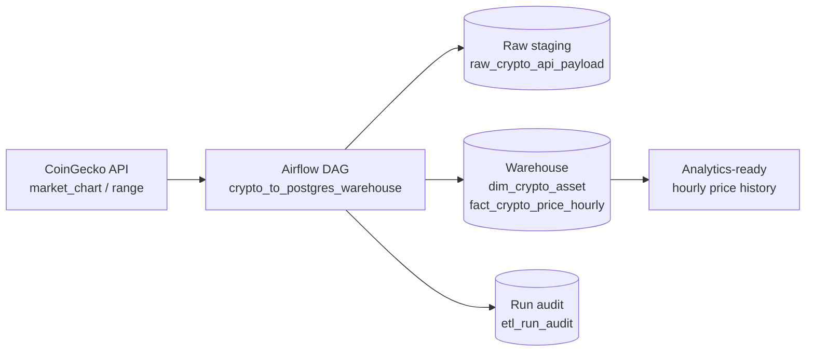

# Airflow Data Warehouse — Crypto Price Pipeline


A scheduled ETL pipeline that ingests hourly cryptocurrency prices from the CoinGecko API and loads them into a PostgreSQL data warehouse, orchestrated with Apache Airflow.

The pipeline runs daily, stages the raw API response for replay, transforms prices to a clean hourly grain, loads them with idempotent upserts, validates the result with data quality checks, and records every run in an audit table.

**Assets tracked**

| Asset | CoinGecko ID | Symbol |
|---|---|---|
| Bitcoin | `bitcoin` | `btc` |
| Ethereum | `ethereum` | `eth` |

---

## Architecture



Docker Compose runs the whole system:

| Service | Image | Role |
|---|---|---|
| `postgres` | `postgres:16` | The data warehouse (`warehouse_postgres`) |
| `airflow-db` | `postgres:16` | Airflow's own metadata database (`airflow-db`) |
| `airflow-init` | `apache/airflow:2.9.3` | Runs `airflow db migrate` and creates the `admin` user |
| `airflow-webserver` | `apache/airflow:2.9.3` | Airflow UI on port `8080` (`airflow_web`) |
| `airflow-scheduler` | `apache/airflow:2.9.3` | Schedules and executes the DAG (`airflow_scheduler`) |

Airflow runs with the `LocalExecutor`. The webserver and scheduler mount `./dags` to `/opt/airflow/dags` and `./sql` to `/opt/airflow/sql`, and reach the warehouse through `WAREHOUSE_HOST`, `WAREHOUSE_PORT`, `WAREHOUSE_DB`, `WAREHOUSE_USER`, and `WAREHOUSE_PASSWORD` environment variables.

---

## The DAG — `crypto_to_postgres_warehouse`

One DAG, defined in `dags/crypto_to_warehouse_dag.py` with the TaskFlow API (`@task`):

- **Schedule:** `@daily`, `catchup=False`, `max_active_runs=1`
- **Start date:** 1 January 2026
- **Tags:** `etl`, `crypto`, `warehouse`
- **Retries:** 2 per task, 2 minutes apart, with an `on_failure_callback` that marks the run's audit row as `failed`
- **Data window:** yesterday in UTC — midnight to midnight — derived from the logical date (`{{ ds }}`)

### Tasks, in order

| # | Task | What it does |
|---|---|---|
| 1 | `create_tables` | Executes `sql/00_create_tables.sql` against the warehouse |
| 2 | `upsert_dim_assets` | Upserts Bitcoin and Ethereum into `dim_crypto_asset` on `asset_id` conflict |
| 3 | `audit_start` | Computes the data window and inserts a `running` row into `etl_run_audit` with run ID `YYYY-MM-DD_to_YYYY-MM-DD` |
| 4 | `extract_stage_transform` | Fetches each asset from CoinGecko, stages the raw JSON, and transforms it to hourly rows |
| 5 | `load_fact` | Bulk-upserts the hourly rows into `fact_crypto_price_hourly` (`execute_values`, page size 500) |
| 6 | `data_quality_checks` | Validates the warehouse — see below |
| 7 | `audit_finish` | Marks the audit row `success` with extracted row count, loaded row count, and total API latency |

A standalone `audit_fail` task is also defined in the DAG file for manually marking a run as failed.

### Extract and transform details

- **Endpoint:** `GET https://api.coingecko.com/api/v3/coins/{id}/market_chart/range` with `vs_currency=usd` and `from` / `to` as Unix timestamps for the data window.
- **API retries:** up to 5 attempts with exponential backoff (`2 ** attempt` seconds) on HTTP `429`, `500`, `502`, `503`, and `504`; any other non-200 response fails the task.
- **Raw staging first:** each asset's full JSON response is stored in `raw_crypto_api_payload` before transformation, so a run is replayable from the warehouse itself.
- **Hourly grain:** each price timestamp (milliseconds, UTC) is floored to the hour, and the last price within an hour wins. Rows come out sorted as `(asset_id, ts, price_usd)`.
- **Idempotent loads:** both the dimension and the fact load use `INSERT … ON CONFLICT DO UPDATE`, and the fact table's primary key is `(asset_id, ts)` — re-running a day overwrites the same hours instead of duplicating them.

### Data quality checks

`data_quality_checks` fails the run unless all of these hold:

| Check | Rule |
|---|---|
| Dimension populated | `dim_crypto_asset` holds at least the 2 tracked assets |
| Fact populated | `fact_crypto_price_hourly` holds at least 10 rows |
| No nulls | No row with a null `asset_id`, `ts`, or `price_usd` |
| No duplicates | No `(asset_id, ts)` group with more than one row |
| Freshness | `MAX(ts)` is at or after the window end minus 2 hours |

---

## Warehouse schema

`sql/00_create_tables.sql` defines the warehouse tables:

### `dim_crypto_asset` — dimension

| Column | Type | Constraints |
|---|---|---|
| `asset_id` | `TEXT` | Primary key |
| `symbol` | `TEXT` | `NOT NULL` |
| `name` | `TEXT` | `NOT NULL` |
| `created_at` | `TIMESTAMP` | `NOT NULL`, default `NOW()` |

### `fact_crypto_price_hourly` — fact, hourly grain

| Column | Type | Constraints |
|---|---|---|
| `asset_id` | `TEXT` | `NOT NULL`, foreign key to `dim_crypto_asset(asset_id)` |
| `ts` | `TIMESTAMP` | `NOT NULL` |
| `price_usd` | `NUMERIC(18, 8)` | `NOT NULL` |
| `load_ts` | `TIMESTAMPTZ` | `NOT NULL`, default `NOW()` |

Primary key: `(asset_id, ts)`.

### `pipeline_state` — pipeline state

| Column | Type | Constraints |
|---|---|---|
| `pipeline_name` | `TEXT` | Primary key |
| `last_success_ts` | `TIMESTAMPTZ` | |
| `update_at` | `TIMESTAMPTZ` | `NOT NULL`, default `NOW()` |

### Operational tables the DAG writes to

The DAG also maintains two operational tables through its own queries:

| Table | Purpose | Key columns |
|---|---|---|
| `raw_crypto_api_payload` | Raw CoinGecko response per run and asset, staged before transformation | `run_id`, `asset_id`, `start_utc`, `end_utc`, `payload_json`, `extracted_at` — upserted on `(run_id, asset_id)` |
| `etl_run_audit` | One row per DAG run and data window, from `running` to `success` or `failed` | `dag_id`, `run_id`, `data_start_utc`, `data_end_utc`, `status`, `extracted_rows`, `loaded_rows`, `api_latency_ms`, `error`, `updated_at` |

---

## Tech stack

| Layer | Technology |
|---|---|
| Orchestration | Apache Airflow 2.9.3 (TaskFlow API, `LocalExecutor`) |
| Warehouse | PostgreSQL 16 |
| Source API | CoinGecko public API (`market_chart/range`) |
| Language & libraries | Python — `requests`, `psycopg2` (`execute_values`, `Json`) |
| Infrastructure | Docker + Docker Compose |

---

## Project structure

```text
airflow-data-warehouse/
├── dags/
│   └── crypto_to_warehouse_dag.py   # DAG: crypto_to_postgres_warehouse
├── sql/
│   └── 00_create_tables.sql         # dim, fact, and pipeline state tables
├── docker-compose.yml               # Warehouse, Airflow DB, init, webserver, scheduler
└── README.md
```

---

## Run it locally

### 1. Configure the environment

Docker Compose reads a `.env` file in the project root. It supplies:

| Variable | Used for |
|---|---|
| `POSTGRES_USER`, `POSTGRES_PASSWORD`, `POSTGRES_DB`, `POSTGRES_PORT` | Warehouse Postgres credentials and host port |
| `AIRFLOW_POSTGRES_USER`, `AIRFLOW_POSTGRES_PASSWORD`, `AIRFLOW_DB_PORT` | Airflow metadata Postgres credentials and host port |

### 2. Start the services

```bash
git clone https://github.com/sajansshergill/airflow-data-warehouse.git
cd airflow-data-warehouse

docker compose up -d postgres airflow-db
docker compose run --rm airflow-init
docker compose up -d
```

### 3. Open Airflow and run the DAG

- UI: http://localhost:8080
- Login: `admin` / `admin` (created by the `airflow-init` service)
- Enable and trigger the DAG: `crypto_to_postgres_warehouse`

The DAG processes yesterday's UTC window on each run. Triggering it loads that day's hourly Bitcoin and Ethereum prices into the warehouse.

---

## Verify the data

Connect to the warehouse:

```bash
docker exec -it warehouse_postgres psql -U warehouse -d warehouse
```

Then query:

```sql
SELECT * FROM dim_crypto_asset;

SELECT asset_id, ts, price_usd
FROM fact_crypto_price_hourly
ORDER BY ts DESC
LIMIT 20;

SELECT dag_id, run_id, status, extracted_rows, loaded_rows, api_latency_ms
FROM etl_run_audit
ORDER BY updated_at DESC;
```
